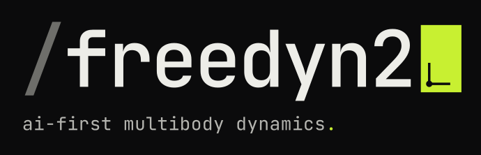

# freedyn2 brand

A small identity for freedyn2: one word mark, one claim, one accent color. The look is a
terminal in a lab: ink and paper, hairlines, monospace, nothing decorative.

## Idea

The logo is a command line: `/freedyn2▮`.

- The **slash** in front reads as a path or a command: freedyn2 is a tool you call.
- The **cursor** at the end is the prompt: someone, often an assistant, talks to the model.
  This is the *ai-first* part (MCP server, Python API, viewer).
- The **body axes** inside the cursor turn it into a rigid body with its own frame: the
  *multibody dynamics* part.

## Name and claim

- Always `freedyn2`, lower case, one word, also at the start of a sentence. Never `FreeDyn2`,
  `FD2` or `freedyn 2`. The full name in running text may be "FreeDyn 2.0" where the history
  with FreeDyn matters; the mark is always `freedyn2`.
- Claim: **ai-first multibody dynamics.** Lower case, English, with the period. Not translated.
  The period takes the cursor color, everything else is one color.

## Logo files (`logo/`)

| file | use |
|---|---|
| `lockup-dark.svg`, `lockup-light.svg` | primary lockup with body axes, on its background |
| `lockup-*-transparent.svg` | the same without background |
| `lockup-small-dark.svg`, `lockup-small-light.svg` | small sizes: plain cursor, no axes |
| `lockup-claim-dark.svg`, `lockup-claim-light.svg` | lockup with claim (README header, title slides) |
| `mark-dark.svg`, `mark-light.svg` | `fd2` in crop marks, square uses |
| `favicon.svg` | slash on the cursor color, 16 to 32 px |
| `app-icon.svg` | slash and cursor with axes on paper, rounded square |
| `avatar.svg` | `fd2` on the cursor color (GitHub, PyPI, social) |

Text in the SVGs is converted to outlines (JetBrains Mono 500/700), so no font is needed.

Rules:

- Body axes only when the cursor is at least **32 px** high. Below that the cursor is a plain block.
- On dark backgrounds the cursor is lime `#C8F031`; on paper it is ink. Lime on paper fails contrast.
- Do not recolor, outline, shadow, rotate or set the word mark in another font. Keep a clear
  space of one cursor width around the lockup.

## Color

| token | hex | use |
|---|---|---|
| ink | `#0B0B0C` | dark ground, text on paper |
| paper | `#EDEDE8` | light ground, text on ink |
| rule | `#3A3A38` | hairlines and grids on ink |
| graphite | `#5E5E5A` | secondary text on paper, slash on paper |
| slash | `#6E6E6A` | slash on ink (large sizes only, not for text) |
| muted | `#8A8A85` | captions on ink |
| soft | `#B5B5B0` | body text on ink |
| cursor | `#C8F031` | cursor, the claim's period, live state. Nothing else. |

The cursor color is the only accent. It marks the cursor and "live" (connected, running), and
is never used for large areas besides the favicon and avatar. Functional status colors in the
viewer (ok, pending, failed) stay functional and are not part of the brand.

## Type

- **JetBrains Mono** (OFL): word mark, UI, labels, code, short headings. Logo weight 500,
  tracking -0.04em; labels lower case.
- **Inter** (OFL): longer running text in the documentation.

## Tokens

[`tokens.json`](tokens.json) is the source of truth; [`tokens.css`](tokens.css) gives the same values
as CSS custom properties (`--fd-*`) with a light and a dark theme and a `.fd-cursor` class.
