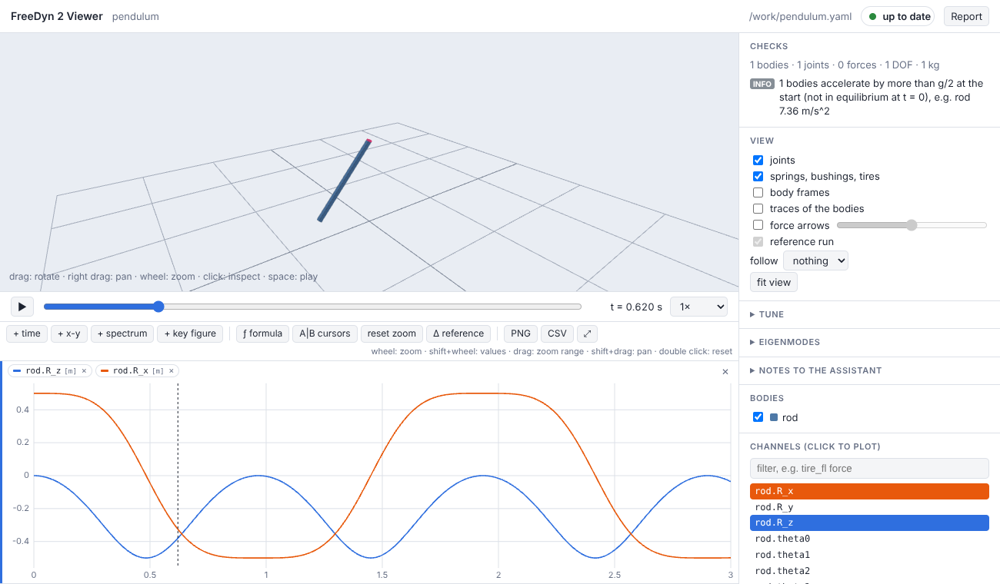

# Getting started

## Install

FreeDyn 2.0 is a Python package with a compiled runtime inside; Windows (x64) and Linux
(x86_64) are supported, with Python 3.10 or newer.

=== "uv (recommended)"

    [uv](https://docs.astral.sh/uv/) installs FreeDyn as a command, with its own Python if
    needed:

    ```sh
    uv tool install freedyn2
    ```

=== "pip"

    ```sh
    pip install freedyn2
    ```

!!! note "Before the first release"
    Until FreeDyn 2.0 is on PyPI, take the wheel for your platform from the artifacts of the
    *Wheels* workflow on GitHub and install it with `pip install freedyn2-0.1.0-py3-none-*.whl`.

Models that use **expression forces or drivers** are compiled into a small plugin and need a
C compiler: on Linux gcc or clang, on Windows the Visual Studio Build Tools (run FreeDyn from a
developer prompt) or MinGW-w64 gcc on the PATH. Everything else – bodies, joints, springs,
bushings, tires – needs none.

Check the installation:

```sh
freedyn2 --help
```

## A first model

A pendulum: one rod on a hinge, released horizontally. Save this as `pendulum.yaml`:

```yaml
model: pendulum
gravity: [0, 0, -9.81]          # SI units throughout: m, kg, s, N, rad
bodies:
  rod:
    mass: 1.0
    inertia: [0.0008, 0.0834, 0.0834]   # principal moments about the center of mass
    position: [0.5, 0, 0]               # center of mass, global, at t = 0
    shapes:                             # for the viewer only
      - {type: box, size: [1.0, 0.04, 0.04]}
joints:
  hinge:
    type: revolute               # turns about the z axis of the joint frame
    body1: rod                   # body2 defaults to the ground
    location: [0, 0, 0]
    orientation: [0.7071068, -0.7071068, 0, 0]   # joint z axis = global y
solver: {type: HHT, end_time: 3.0, step: 0.001, output_step: 0.01}
```

Three rules cover most of the format:

1. **Everything is given globally at t = 0** – positions of bodies (their centers of mass),
   joint locations, points of springs. FreeDyn works out where they sit on each body.
2. **Orientations are unit quaternions** `[θ0, θ1, θ2, θ3]` (Euler parameters, θ0 the scalar
   part). The few you need most are in the [model file reference](reference/model-file.md#orientations).
3. **Units are SI.** The checks warn when gravity, lengths or masses look like mm or g.

## Run it

```sh
freedyn2 run pendulum.yaml            # writes pendulum.csv
freedyn2 check pendulum.yaml --run    # plausibility checks of the model and its results
```

The result is a CSV file with one column per channel: positions `rod.R_x`, velocities,
energy, joint forces … ([result channels](reference/results.md)).

## Look at it

```sh
freedyn2 view pendulum.yaml
```

The browser opens with the model in 3D, a timeline and the list of channels. Click
`rod.R_z` in the list to plot it, press space to play. Now edit `pendulum.yaml` – change the
mass, move the hinge – and save: the viewer simulates again and shows the new run next to the
old one. That loop, *edit, save, look*, is the whole idea; the [viewer page](viewer.md) shows
everything else it can do.



## Next

- The [tutorial](tutorial.md) tunes a quarter car with sliders, compares runs and studies
  variants.
- [Working with an assistant](assistants.md) connects Claude (or another MCP client) so it
  can write and run models for you.
- The [examples](examples.md) range from a pendulum to a double-wishbone suspension and a car
  on an OpenCRG road.
