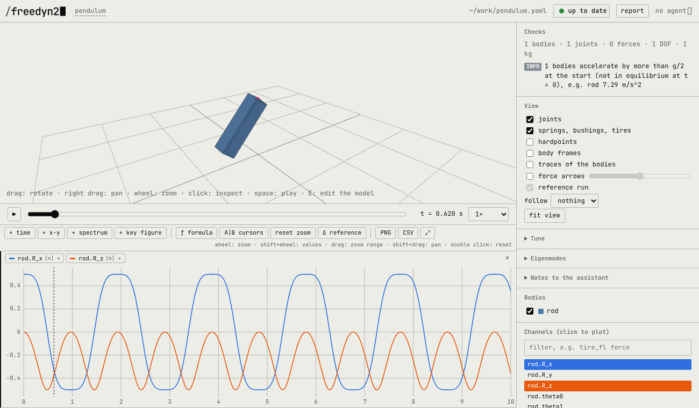

# Getting started

## Install

freedyn2 runs on Windows (x64) and Linux (x86_64). It comes in two forms: a Windows
installer that sets up a program, and a Python package for use from Python.

### Which way suits me?

| you want to | take |
|---|---|
| use FreeDyn as a program on Windows: the app window, the command line, an assistant; no Python needed | the **Windows installer** |
| use FreeDyn from your own Python, Jupyter or scripts, or on Linux | **uv** or **pip** |

Both give the same `freedyn2` command and the same results. They can be installed side by
side; each has its own Python.

!!! note "Before the first release"
    The installer comes with the first release; until then there is no download. Until
    freedyn2 is on PyPI, take the wheel for your platform from the artifacts of the *Wheels*
    workflow on GitHub and install it with `pip install "freedyn2-0.1.0-py3-none-<platform>.whl[gui,compiler]"`.

=== "Windows installer"

    Download [`freedyn2-setup.exe`](https://github.com/freedyn-org/freedyn2/releases/latest/download/freedyn2-setup.exe)
    from the GitHub releases and run it. It installs for the current user, without
    administrator rights, and brings its own private Python. A legacy FreeDyn on the same
    machine is not touched ([Coming from FreeDyn](from-freedyn.md)). Later also:
    `winget install freedyn-org.freedyn2`.

    The installer asks for components:

    | component | default | |
    |---|---|---|
    | C compiler (Zig) | on | for models with expression forces or drivers (see below) |
    | examples | on | the example models |
    | add to PATH | on | `freedyn2` in every command prompt |
    | associate `.fds` | off | double click opens a legacy model in freedyn2 |
    | "Open with freedyn2" for `.yaml` | off | in the context menu of model files |
    | register with Claude Desktop | off | the [MCP server](assistants.md) for Claude Desktop |
    | desktop icon | off | |

    The start menu then has **freedyn2** (the app window: open a model, recent models,
    examples, the documentation), **freedyn2 Command Prompt** (a prompt with `freedyn2` on
    the PATH) and **freedyn2 Documentation**.

    For rollouts: `freedyn2-setup.exe /VERYSILENT /CURRENTUSER` installs without questions.

=== "uv"

    [uv](https://docs.astral.sh/uv/) installs FreeDyn as a command, with its own Python if
    needed:

    ```sh
    uv tool install "freedyn2[gui,compiler]"
    ```

=== "pip"

    Into the current environment (a virtual environment, conda, the Python of your Jupyter):

    ```sh
    pip install "freedyn2[gui,compiler]"
    ```

The extras are optional: `gui` (pywebview) opens `freedyn2 gui` in a window of its own
instead of the browser; `compiler` (ziglang) brings a C compiler that FreeDyn finds by itself.
`pip install freedyn2` alone is enough for the command line, the viewer in the browser and
the MCP server.

!!! warning "The installer's Python is private"
    The Python inside the Windows installation serves FreeDyn only. To use FreeDyn from your
    own Python or Jupyter (`import freedyn2`, see the [Python API](python-api.md)), install it
    into that environment with `pip install freedyn2`, even if the installer is there too.

### The C compiler

Models with **expression forces or drivers** are compiled into a small plugin and need a C
compiler. Everything else (bodies, joints, springs, bushings, tires) needs none.

The installer (component *C compiler*) and the `compiler` extra bring Zig, which FreeDyn
finds by itself. Other options:

- Linux: gcc or clang, as installed by the system.
- Windows: the Visual Studio Build Tools (found with vswhere, no developer prompt needed) or
  MinGW-w64 gcc on the PATH.

`freedyn2 config compiler zig|msvc|auto|<path>` chooses one (`auto`: the first one found);
the `CC` environment variable overrides the setting.

### Check the installation

```sh
freedyn2 --version
freedyn2 doctor
```

`freedyn2 doctor` shows what FreeDyn found on your machine (its Python, the runtime, the C
compiler and more). Add its output when you ask for help.

### Updating and uninstalling

FreeDyn does not update itself. The app shows a notice when a newer release is on GitHub (it
looks once a day; `freedyn2 config update_check false` or `FREEDYN2_NO_UPDATE_CHECK=1` turns
that off).

| | update | uninstall |
|---|---|---|
| Windows installer | download the new `freedyn2-setup.exe` and run it over the old installation | Windows Settings > Apps > freedyn2 |
| uv | `uv tool upgrade freedyn2` | `uv tool uninstall freedyn2` |
| pip | `pip install -U freedyn2` | `pip uninstall freedyn2` |

Uninstalling keeps your settings and caches in `%APPDATA%\freedyn2` and
`%LOCALAPPDATA%\freedyn2` (Windows); delete these folders to remove everything. Your model
files are never touched.

## A first model

A pendulum: one rod on a hinge, released horizontally. Save this as `pendulum.yaml`:

```yaml
model: pendulum
gravity: [0, 0, -9.81]          # SI units throughout: m, kg, s, N, rad
bodies:
  rod:
    mass: 1.0
    inertia: [0.0008, 0.0834, 0.0834]   # principal moments about the center of mass
    position: [0.5, 0, 0]               # center of mass, global, at t = 0
    shapes:                             # for the viewer only
      - {type: box, size: [1.0, 0.04, 0.04]}
joints:
  hinge:
    type: revolute               # turns about the z axis of the joint frame
    body1: rod                   # body2 defaults to the ground
    location: [0, 0, 0]
    orientation: [0.7071068, -0.7071068, 0, 0]   # joint z axis = global y
solver: {type: HHT, end_time: 3.0, step: 0.001, output_step: 0.01}
```

Three rules cover most of the format:

1. **Everything is given globally at t = 0** – positions of bodies (their centers of mass),
   joint locations, points of springs. FreeDyn works out where they sit on each body.
2. **Orientations are unit quaternions** `[θ0, θ1, θ2, θ3]` (Euler parameters, θ0 the scalar
   part). The few you need most are in the [model file reference](reference/model-file.md#orientations).
3. **Units are SI.** The checks warn when gravity, lengths or masses look like mm or g.

## Run it

```sh
freedyn2 run pendulum.yaml            # writes pendulum.csv
freedyn2 check pendulum.yaml --run    # plausibility checks of the model and its results
```

The result is a CSV file with one column per channel: positions `rod.R_x`, velocities,
energy, joint forces … ([result channels](reference/results.md)).

## Look at it

```sh
freedyn2 view pendulum.yaml
```

The browser opens with the model in 3D, a timeline and the list of channels. Click
`rod.R_z` in the list to plot it, press space to play. Now edit `pendulum.yaml` – change the
mass, move the hinge – and save: the viewer simulates again and shows the new run next to the
old one. That loop, *edit, save, look*, is the whole idea; the [viewer page](viewer.md) shows
everything else it can do.

`freedyn2 gui pendulum.yaml` shows the same in a window of its own (with the `gui` extra or
the Windows installer; the start menu entry **freedyn2** opens it with a start page).



## Next

- [Coming from FreeDyn](from-freedyn.md): your `.fds` models in freedyn2.
- The [tutorial](tutorial.md) tunes a quarter car with sliders, compares runs and studies
  variants.
- [Working with an assistant](assistants.md) connects Claude (or another MCP client) so it
  can write and run models for you.
- The [examples](examples.md) range from a pendulum to a double-wishbone suspension and a car
  on an OpenCRG road.
