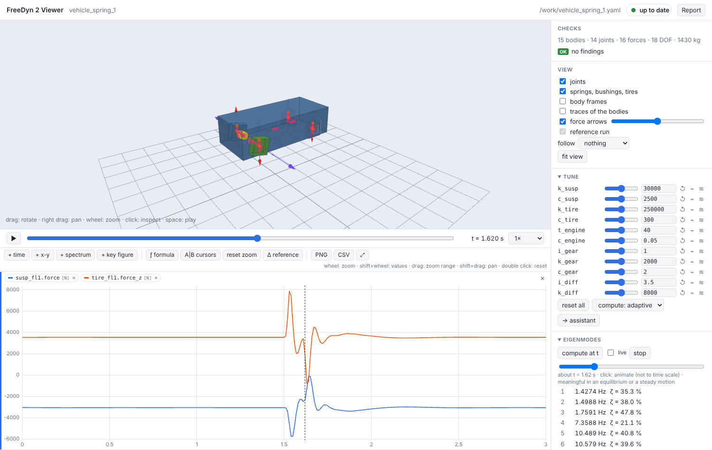

# FreeDyn 2.0

**Multibody dynamics for engineers – and for the assistants they work with.**

FreeDyn 2.0 simulates mechanical systems of rigid bodies, joints and forces: suspensions,
drivelines, mechanisms, vehicles on roads, motorcycles. A model is a short text file; a
viewer in the browser shows it, plays the results and lets you tune, compare and study
variants; an AI assistant can build and change the model through the same tools you use.

## What it is good at

- **Models as text.** A model is a YAML file of bodies, joints and forces, written by hand or
  by an assistant, reviewed like code, versioned with git. Every number can be a formula of
  named parameters: `stiffness: =k_front`.
- **Checking before trusting.** The viewer and `freedyn2 check` find what is physically
  impossible or likely a slip: inertia no body has, units, a joint far from its bodies,
  redundant constraints, a tire in the air. References (total mass, measured curves) are
  checked with every run.
- **Interactive variant studies.** Sliders for every parameter, runs compared to a reference
  with difference plots, a fan of seven variants simulated in parallel with key figures over
  the parameter, live eigenvalues and root loci while you move a slider.
- **Fast and exact.** The equations and their derivatives are generated symbolically
  (CasADi) and compiled to plain C; a small C++ runtime integrates them (HHT on a Lie group).
  A car with tires on an OpenCRG road takes about 0.15 ms per step; a fixed
  Newton mode does exactly the same work every step, for real-time use.
- **Open.** Apache 2.0. The successor of the FreeDyn freeware, with an importer for its
  `.fds` models.

## Where to start

- **[Getting started](getting-started.md)** – install, a first model, the viewer, in ten minutes.
- **[Tutorial](tutorial.md)** – tune a quarter car over a bump: sliders, runs, a fan of
  variants, eigenvalues.
- **[Working with an assistant](assistants.md)** – let Claude or another MCP client build and
  examine models while you check and decide.
- **[Coming from Adams](from-adams.md)** – the concepts side by side.
- **[Model reference](reference/model-file.md)** – every element and key.
- **[Examples](examples.md)** – models to open, with live viewers on the page.

## The way of working

FreeDyn 2.0 is built for a division of labour: **an assistant writes and changes the model,
a person checks and decides.** That only works if checking is cheaper than modelling, so the
tools for looking at a model – the viewer, the checks, the comparison of runs, notes back to
the assistant – are as important as the solver. You can of course write every model by hand;
the file format is meant to be read and written by people.
