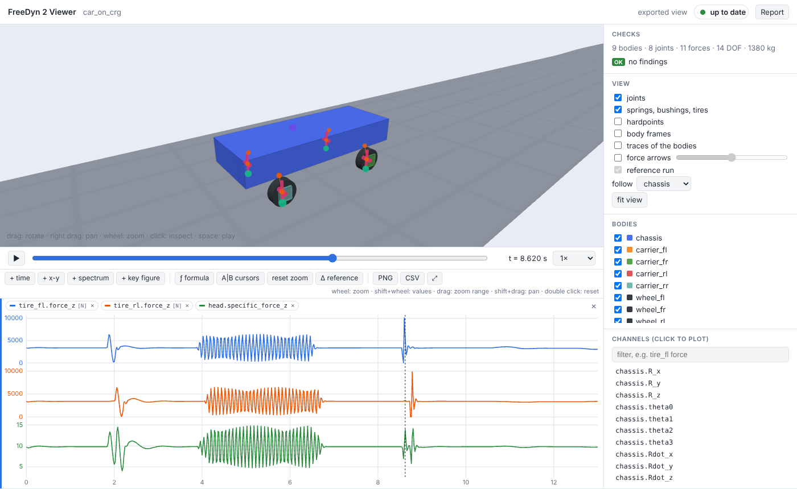

# Tutorial – a car on an OpenCRG road

A car drives over a test track stored as an ASAM OpenCRG file: a speed bump, a washboard
section, a pothole under the left wheels only, banking. We look at how the road is made, how
the car is put together from hardpoints, what the tires and a sensor at the driver's head
see, and why the washboard shakes the wheels so much. About 30 minutes.

```sh
freedyn2 examples car_on_crg     # copies car_on_crg.yaml and data/test_track.crg
freedyn2 view car_on_crg.yaml
```



## 1. The road

OpenCRG describes a road as a grid of heights along a reference line: `u` along the line, `v`
across it (left positive), with optional heading, slope and banking of the line. FreeDyn reads
CRG files with the official OpenCRG library, in all its data formats.

The test track was written with FreeDyn's own CRG writer, `fdgen.crg.write_crg`, by
`data/make_test_track.py`; it is the place to start for a road of your own:

```python
from fdgen.crg import write_crg
u = np.arange(0.0, 220.0 + 1e-9, 0.1)          # 10 cm along the road
v = np.arange(-4.0, 4.0 + 1e-9, 0.1)           # 8 m wide
z = ...                                         # heights [len(u) x len(v)]
write_crg("test_track.crg", 0.1, v, z, bank=bank, fmt="KRBI")
```

| at | feature |
|---|---|
| 30 m | speed bump over the full width, 6 cm high, 3 m long |
| 60–100 m | washboard: 8 mm amplitude, 1.2 m wavelength |
| 130 m | pothole in the **left** wheel track only, 5 cm deep |
| 160–200 m | banking 4 %, falling to the right |

The model refers to the file in its `road` section (the path is relative to the model file):

```yaml
road:
  crg: data/test_track.crg
  friction: 1.0
```

`position` and `heading` would place the road elsewhere; `crg_friction` would read a second
grid of friction coefficients. To check a road without a model, ask it for heights:

```sh
echo "130 0.8
130 -0.8" | freedyn2_road data/test_track.crg
```

prints height, gradient and friction at both points: −5 cm in the left track, 0 in the right.

## 2. The car

Open `car_on_crg.yaml`. The car is a chassis, four wheel carriers on vertical prismatic joints
with spring-dampers, and four wheels on revolute joints. The geometry is written once, as
[hardpoints](reference/hardpoints.md); the right side mirrors the left:

```yaml
parameters:
  z_wheel: =r0 - (m_chassis / 4 + 45) * 9.81 / k_tire   # the wheel center at rest: tire deflected
points:
  wheel_fl: [2.6, 0.8, =z_wheel]
  wheel_fr: {mirror: wheel_fl}
  top_fl: {from: wheel_fl, offset: [0.0, -0.1, 0.35]}    # the spring's upper mount
  ...
frames:
  axle: {z: [0, 1, 0]}                                   # the wheels turn about global y
joints:
  guide_fl: {type: prismatic, body1: carrier_fl, body2: chassis, location: wheel_fl}
  hub_fl: {type: revolute, body1: wheel_fl, body2: carrier_fl, location: wheel_fl, orientation: axle}
```

The wheel center height is a formula: the tire is compressed by the static load, so the car
starts at rest instead of dropping onto its tires. The spring preload carries a quarter of the
chassis in the same way.

**Tires.** The built-in tire element (`type: tire`) finds the contact point on the road below
the wheel center in every step – on the CRG road too – with a vertical spring and damper, lift
off, and Magic Formula longitudinal and lateral forces:

```yaml
  tire_fl: {type: tire, body1: wheel_fl, radius: =r0, tire: {kz: =k_tire}}
```

**Driving.** There is no driveline: an expression torque on each rear wheel is a speed
controller, the torque proportional to the speed error, with a measure of the chassis speed;
air drag is an expression force:

```yaml
  drive_rl: {type: expression_torque, body1: wheel_rl, body2: carrier_rl, axis: [0, 1, 0], frame: body,
             torque: k_speed * (v_set - vx)}
  air: {type: expression_force, body1: chassis, direction: [1, 0, 0], force: -c_air * vx * abs(vx)}
measures:
  vx: {type: velocity, body1: chassis, component: x}
```

**A sensor at the driver's head** gives what a motion platform would have to reproduce: the
specific force (acceleration minus gravity: +9.81 upwards at rest) and the angular velocity,
in the car's axes – see [Sensors and accelerations](reference/sensors.md):

```yaml
sensors:
  head: {body1: chassis, point: head}
```

The checks say *9 bodies · 8 joints · 11 forces · 14 DOF · 1380 kg* and *no findings*.

## 3. Drive

Press space; *follow* the chassis. Plot the vertical tire forces of a front and a rear wheel,
`tire_fl.force_z` and `tire_rl.force_z`, and the head's `head.specific_force_z`:

- **The bump** (≈ 2 s): the front wheels nearly lift off (the load drops from 3.4 kN to
  under 0.1 kN), the rear wheels follow 0.17 s later; the head sees 4 to 15 m/s².
- **The washboard** (4–6.5 s): the wheel loads swing by ±3 kN, much more than 8 mm of road
  suggest. Step 4 explains why.
- **The pothole** (≈ 8.6 s): only the left wheels drop in – the front left load swings by
  10 kN, the front right (`tire_fr.force_z`) by 0.4 kN. Plot `chassis.omega_x`: the car rolls
  (0.1 rad/s).
- **The banking** (11–13 s): the car drifts to the right (`chassis.R_y`, about 10 cm). It has
  no steering – a driver would steer against it.

## 4. Why the washboard shakes: the wheel hop

Open **Eigenmodes** and compute at t = 1 s, on the smooth road. Besides the body modes
(bounce, pitch and roll at 1.1–1.5 Hz) there are four **wheel hop** modes at 10.9 to 11.6 Hz,
damped by about 38 %: the wheel and carrier bouncing between tire and spring.

The washboard has a wavelength of 1.2 m; at 15 m/s the wheels cross 12.5 waves per second –
just above the wheel hop frequency. The road excites the wheels close to their resonance.

## 5. A fan of dampers

Zoom the time plots to the washboard (4.3–6.2 s) and press **≋** at `c_front`: seven front
dampers at once. Add a **key figure** plot and choose *peak-peak*:

| `c_front` [N s/m] | 500 | 1000 | 1500 | 2000 | 2500 | 3000 | 4000 |
|---|---|---|---|---|---|---|---|
| `tire_fl.force_z`, peak-peak [N] | 9399 | 8276 | 7399 | 6831 | 6142 | 5623 | 5151 |

Harder dampers hold the wheel on the road. What they cost in comfort shows the head sensor's
specific force – try it on the bump.

## 6. Change the road

Edit `data/make_test_track.py` – a longer washboard, a second pothole on the right, a curve
(a heading per segment, `phi`) – run it, and the viewer simulates again: the road is read
afresh with the model.

With a curve the car needs a driver. The simplest is a steering joint at the front wheels and
a driver ([`drivers`](reference/measures.md#drivers)) that follows a steering angle over time;
a path-following controller is an expression of measures of the car's position.

## What next

- [Tires and roads](reference/tires-roads.md): the tire's parameters and the road options.
- [Sensors and accelerations](reference/sensors.md): the channels of the head sensor and what
  motion cueing needs.
- [Hardpoints and frames](reference/hardpoints.md): building suspensions from points.
