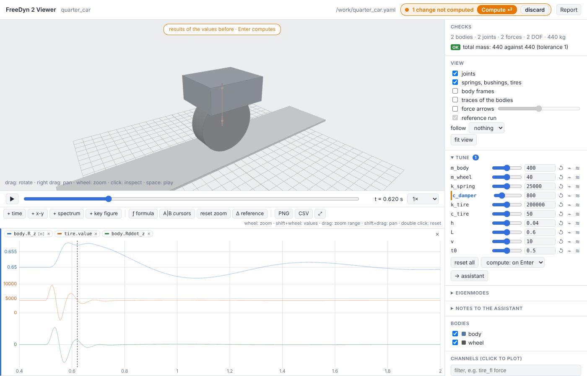
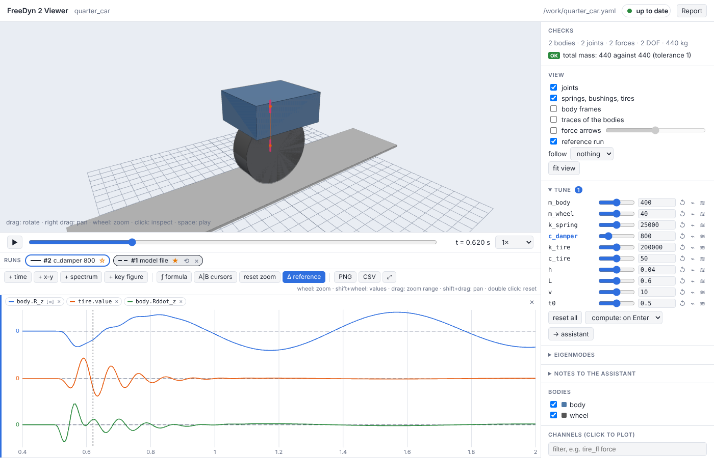
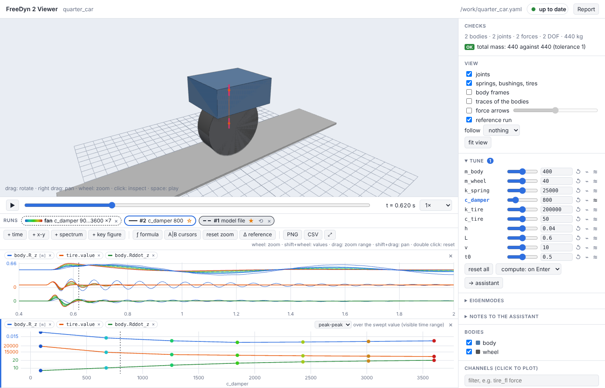
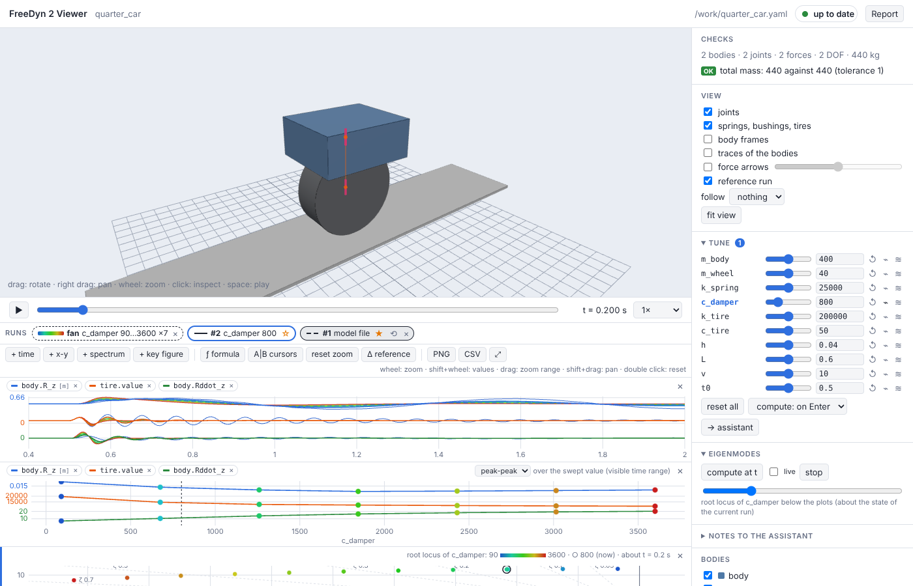

# Tutorial – tuning a quarter car

A quarter car crosses a bump. We look at the model, tune the damper with a slider, compare
runs, let FreeDyn simulate seven dampers at once, and read the trade-off between comfort and
road holding off a key figure plot – then check it against the eigenvalues. About 20 minutes.

```sh
freedyn2 examples quarter_car     # copies quarter_car.yaml into the current directory
freedyn2 view quarter_car.yaml
```

## 1. The model

Open `quarter_car.yaml` in an editor next to the viewer. It has two bodies – a quarter of the
car body (400 kg) and the wheel (40 kg) – each moving only vertically:

```yaml
parameters:
  m_body: 400.0      # [kg] a quarter of the car
  m_wheel: 40.0      # [kg] wheel, hub, brake, half the link masses
  k_spring: 25000.0  # [N/m] suspension spring
  c_damper: 1800.0   # [N s/m] suspension damper
  k_tire: 200000.0   # [N/m] tire, vertical
  ...
bodies:
  body:
    mass: =m_body                   # a formula of the parameters
    ...
joints:
  body_guide: {type: prismatic, body1: body, location: [0, 0, 0.65]}       # vertical only
  wheel_guide: {type: prismatic, body1: wheel, body2: body, location: [0, 0, 0.3]}
forces:
  suspension:
    type: spring_damper
    body1: wheel
    body2: body
    stiffness: =k_spring
    damping: =c_damper
    preload: =-m_body * 9.81        # compression carries the body
  tire:
    type: expression_force          # a force law you write yourself
    body1: wheel
    direction: [0, 0, 1]
    force: >-
      (m_body + m_wheel) * 9.81
      + k_tire * (if_else((t > t0) * (t < t0 + L / v), 0.5 * h * (1 - cos(2 * pi * v * (t - t0) / L)), 0) - z_wheel)
      - c_tire * vz_wheel
```

- **`parameters`** are named numbers. Any number in the model can be a formula of them,
  written with `=` as in a spreadsheet. The viewer turns every parameter into a slider.
- The **prismatic joints** leave each body one direction to move in: the joint's z axis,
  vertical by default.
- The **tire** is an expression force: the static load, plus the tire spring compressed by
  the road height under the wheel minus the wheel's travel `z_wheel`. The road is a cosine
  bump of height `h` and length `L`, crossed at speed `v` from `t0` on. `z_wheel` and `vz_wheel` are
  [measures](reference/measures.md) defined at the end of the file.

The **Checks** panel says *2 bodies · 2 joints · 2 forces · 2 DOF · 440 kg* and *no
findings*; the total mass is also checked against the reference in the file's `checks`
section.

## 2. Look at the results

Press space to play. Then plot, by clicking in the channel list on the right:

- `body.R_z` – the height of the car body,
- `tire.value` – the vertical tire force (the wheel load),
- `body.Rddot_z` – the vertical acceleration of the body, our comfort measure. It is the
  acceleration the solver computes, not a difference quotient of the velocity.

With **ƒ formula** you add channels that are not in the results, e.g. the suspension travel
`travel = body.R_z - wheel.R_z`.

Drag a range in a plot to zoom to the bump (0.4 to 2 s); all time plots follow.

## 3. Tune the damper

Open **Tune** on the right. Every parameter has a slider. Set `c_damper` to 800 and watch
the header:



- The header turns **amber**: *1 change not computed*. The 3D view and the curves fade –
  they still show the results of the old values.
- With the default policy *adaptive*, a model this fast (a quarter of a second) is computed
  right away; a slower one waits for **Compute ⏎** or Enter. While it computes, the header is
  **blue** and the new curves grow over the faded ones.
- When it is done the header is **green** again: *up to date*.

The model file has not changed. Tuned values live in the viewer until you take them over
(step 8).

## 4. Compare runs

Every simulation is a **run** in the strip above the plots: *#1 model file*, *#2 c_damper 800*.
Click ☆ on #1 to make it the **reference**: its curves are dashed in every plot, its bodies
grey in the 3D view. Then press **Δ reference**: the plots show each run *minus* the
reference – small differences that hide in an overlay become obvious.



## 5. A fan of variants

Instead of trying one damper after another, press **≋** next to the `c_damper` slider: seven
values over the slider's range are simulated at once, in parallel. The time plots show them as
a fan, blue for the softest, red for the hardest. A **key figure** plot appears below: choose
*peak-peak* – it is taken over the visible time range, so zoom to the bump first.



The two key figures pull in opposite directions:

| `c_damper` [N s/m] | 90 | 675 | 1260 | 1845 | 2430 | 3015 | 3600 |
|---|---|---|---|---|---|---|---|
| body acceleration `body.Rddot_z`, peak-peak [m/s²] | 7.0 | 10.4 | 13.9 | 16.5 | 18.2 | 19.3 | 20.2 |
| tire force `tire.value`, peak-peak [kN] | 19.7 | 14.7 | 12.8 | 12.3 | 11.8 | 11.5 | 11.3 |

(over 0.4 to 2 s; the slider's range is 0 to twice the file's value, the fan starts a little
above 0)

A soft damper is comfortable (small body acceleration) but lets the wheel load swing – less
grip on a bumpy road; a hard one keeps the wheel on the road and shakes the passengers. The
key figure plot shows where the knee is.

## 6. Why: the eigenvalues

Open **Eigenmodes** and press *compute at t* (at a time before the bump, when the car is at
rest). Two modes:

- **body bounce** at 1.17 Hz, damping ratio 24 %,
- **wheel hop** at 11.2 Hz, damping ratio 32 %.

Click one to see it move. Now tick **live** and move the `c_damper` slider: the frequencies
and damping ratios follow at once, before anything is simulated (▲▼ shows the change). At
500 N s/m both modes are barely damped (7 % and 9 %); at 5000 the body mode is critically
damped – the car no longer bounces, it is held. Press **⌁** next to the slider for the whole
picture, the **root locus**: each eigenvalue for eleven damper values, coloured from soft to
hard, with lines of equal damping ratio.



## 7. Notes to the assistant

If an assistant works on this model with you ([Working with an assistant](assistants.md)),
open **Notes to the assistant** and write what you found, e.g. *"c_damper 2400 is the best
compromise, take it into the model"*. The note carries the time, the selected element, the
plotted channels, the tuned values and a picture of the view; the assistant reads it, changes
the file and answers – the answer appears under the note.

## 8. Keep the result

Tuned values are not written into the model file by the viewer – the file stays yours (or
your assistant's). Either type the value into the file (the viewer reloads and shows the run
as *file v2*), or send it with **→ assistant**. **Report** writes one HTML file with the
view, the plots, the checks, the tuned values and the eigenmodes, to print or pass on.

## What next

- Change the model: give the body pitch by adding a second wheel, or replace the expression
  tire by the [`tire` element](reference/tires-roads.md) on a road.
- Read the [viewer page](viewer.md) for the plots (x-y, spectrum, cursors, formulas).
- Let an [assistant](assistants.md) run a sweep over two parameters and report the best pair.
