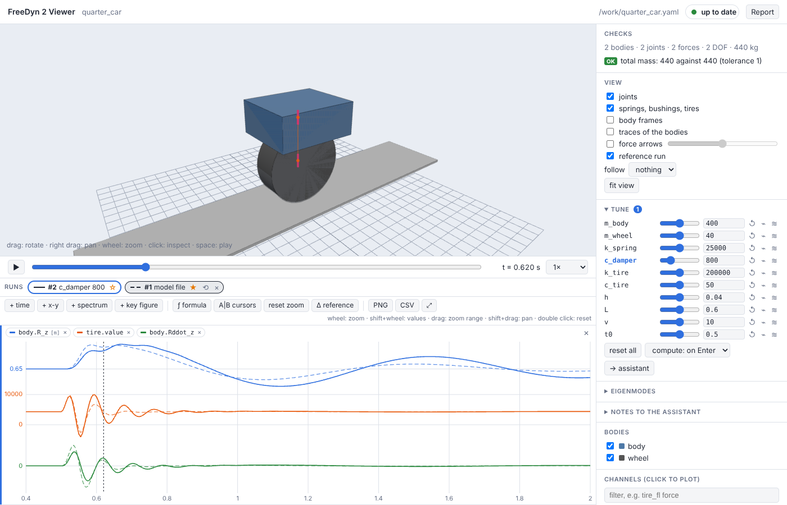

# The viewer

```sh
freedyn2 view model.yaml                    # simulate and show; again after every save
freedyn2 view model.yaml result.csv         # show these results
freedyn2 view model.yaml --no-run           # the model at t = 0
freedyn2 view model.yaml -- --end-time 2    # options for the solver after --
freedyn2 view model.yaml --export page.html # one HTML file to pass on (no server needed)
```

The viewer is a page in your browser, served on `http://127.0.0.1:8765/` (`--port`). It works
offline. Every save of the model file – by you, in any editor, or by an assistant – rebuilds
and simulates again; an invalid model is reported over the last valid one, so you can keep
editing with the viewer open.


## 3D view and timeline

- Drag to rotate, right-drag to pan, wheel to zoom; *fit view*; *follow* a body (a model that
  drives away is followed by itself).
- Space plays, the arrow keys step, the speed menu slows down or speeds up.
- Bodies are drawn with their [shapes](reference/bodies.md#shapes), or as the box of their
  mass and inertia if they have none; joints, springs, bushings and tire contacts are marked.
  *View* shows body frames, traces, **force arrows** (forces red, torques purple, scaled to
  the largest of the run) and the reference run.
- **Click an element** to inspect it: its data, its result channels (click to plot), its
  findings and its YAML text with the line in the model file. What it is connected to stays,
  the rest fades.

## Plots

Below the 3D view (drag the border to resize, ⤢ for large plots):

- **over time**: all plots share the time axis. Wheel zooms, dragging zooms to a range,
  shift+drag pans, double click resets. The values of every channel under the mouse; a click
  sets the time of the animation. Channels of very different size get their own lanes.
- **x-y**: a channel over another (toe over wheel travel), with a marker at the current time.
- **spectrum**: the amplitude spectrum of the visible time range, with its peak.
- **A|B cursors**: values at A and B, the difference, Δt and 1/Δt, min, max, mean and rms
  between them.
- **ƒ formula**: channels from formulas, e.g. `v_kmh = hypot(chassis1.Rdot_x, chassis1.Rdot_y) * 3.6`
  or `a = der(body.Rdot_z)`. Functions: sin, cos, tan, asin, acos, atan, atan2, sqrt, abs, exp,
  log, log10, min, max, hypot, sign, deg, rad, der (time derivative: central differences of the
  output samples, so it depends on `output_step` and smooths peaks), int (time integral:
  trapezoids). The raw accelerations are channels of their own: `Rddot_*` of the bodies and
  [sensors](reference/sensors.md).
- **PNG** and **CSV** export of the plots (CSV: the visible time range). Plots and formulas
  are remembered per model.

Add channels by clicking them in the list (to the active plot, marked at its left edge) or by
dragging them onto a plot.

## Checks

The *Checks* panel lists what `freedyn2 check` finds: errors (inertia no body has, springs of
length zero, non-finite results), likely slips (units, a joint far from its bodies, redundant
constraints, a tire in the air, parameters no expression uses) and what you should know
(degrees of freedom, bodies not connected to the ground, bodies not at rest at the start),
and the references of the model's `checks` section, passed or failed. Click a finding to
select the element. See [Checks and references](reference/checks.md).

## Is the result current?

The header shows whether the results belong to what is set:

| | |
|---|---|
| 🟢 **up to date** | the results are those of the values shown |
| 🟠 **N changes not computed** | values were changed: the 3D view and the curves fade. **Compute ⏎** or Enter computes, *discard* goes back |
| 🔵 **computing N %** | the new curves grow over the faded ones while the simulation runs |
| 🔴 **error** | the message, over the last good results |

When to compute is set in *Tune*: **adaptive** (by itself when the last run took less than
1.5 s, else on Enter), **always**, or **on Enter**. A new computation stops the one still
running.

## Tune

The model's `parameters` get sliders; any other number joins them with a click on it in the
inspector (*tune: mass stiffness point1.z …*). Fields written as formulas (`stiffness:
=k_spring`) link to their parameters. Parameters no expression uses are greyed out.

Tuned values are **not written into the model file**: the server keeps them (until *reset
all*) and applies them to every rebuild. Take them over by editing the file, or send them to
the assistant (*→ assistant*).

Next to each slider: ↺ back to the file's value, **⌁** root locus, **≋** fan.

## Runs

Every simulation is a run in the strip above the plots, labelled with what differs from the
model file (tuned values, *file v2* after an edit). Click a run to show it dashed in the
plots; ☆ makes it the **reference** (grey bodies in 3D, dashed curves, the base of **Δ
reference**: every run minus the reference); ⟲ takes its values back into Tune; × removes it.



## Fan and key figures

**≋** at a slider simulates seven values over its range at once, in parallel: a fan of curves
in the time plots, blue for the first value, red for the last; a card in the run strip
(progress, show/hide, ×). **+ key figure** adds a plot of a key figure – max, min, max |x|,
peak-peak, mean, rms, final – of the channels over the swept value, taken over the visible
time range: zoom to an event to get its key figures.

## Eigenmodes and root locus

*Eigenmodes* linearizes the model about the state at the current time and lists frequencies
and damping ratios; click a mode to animate it. This is meaningful in an equilibrium or a
steady motion (straight running, a steady turn). With **live**, the eigenvalues follow the
sliders at once, before simulating – about the positions and velocities of the current run,
with the constraint forces of the changed model.

**⌁** at a slider computes the eigenvalues for eleven values over its range: the **root
locus**, real part over frequency, coloured by the value, with lines of equal damping ratio.

## Notes to the assistant

*Notes to the assistant* takes a text; the time, the selected element, the plotted channels,
the tuned values, the eigenmode shown and (optionally) a picture of the view go with it. Notes
are files next to the model (`<model>.notes/`); the assistant reads them with the MCP tool
`notes`, answers with `answer_note`, and the answer appears under your note.

## Report and export

**Report** writes one HTML file with the view, the plots, the checks, the tuned values, the
eigenmodes and the notes – print it to PDF from the browser. `freedyn2 view --export page.html`
writes the whole viewer with the model and its results into one HTML file that anyone can
open without FreeDyn (the [examples](examples.md) on this site are such files).
